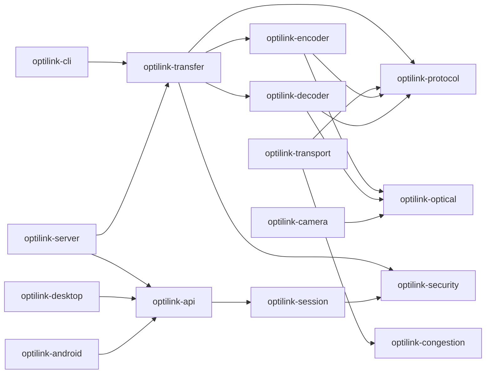

# OptiLink

Zero-Trust Optical Communication Platform.

OptiLink is a Java 21 multi-module foundation for an application-layer optical communication protocol that sends authenticated, reliable messages through displays and cameras only. The implementation now includes a practical MVP path plus a production-shaped protocol core: passphrase-sealed encrypted QR transfers for text, images, videos, and files; animated browser QR beam pages; browser camera receiver scanning; QR decoding and reassembly; binary packet framing; packet integrity; identity and session cryptography primitives; reliable transport; adaptive optical profiles; compression; camera frame-quality feedback; adapter boundaries; documentation; tests; and benchmarks.

This repository is not a QR generator and not a file sharing app. QR-compatible dynamic symbols are treated as one possible optical physical representation beneath a custom protocol stack.

## Build

```bash
mvn test
```

The current verified build passed on 2026-08-13 with Java 25 compiling Java 21 release bytecode.

## Run The Product

```bash
mvn -f optilink-server/pom.xml spring-boot:run -Dspring-boot.run.arguments="--server.port=8080 --optilink.transfer.root=target/optilink-product-transfers"
```

Open `http://localhost:8080`.

Use the web console to create `Text`, `Image`, `Video`, or `File` transfers, open the generated QR beam, then receive from another browser with the camera scanner. Full setup, product workflow, CLI usage, REST API examples, benchmarks, and troubleshooting are in [Setup And Running Guide](optilink-documentation/SETUP.md).

Docker and free Render deployment steps are in [Docker And Free Deployment Guide](optilink-documentation/DOCKER_DEPLOYMENT.md).
CI/CD setup is in [CI/CD Pipeline](optilink-documentation/CICD.md).
The multi-user runtime and scaling boundary are in [Production MVP Architecture](optilink-documentation/PRODUCTION_MVP.md).
The detailed file-by-file handoff and refactoring guide is in [Project Handoff](optilink-documentation/PROJECT_HANDOFF.md).
The two-device demo script is in [Live Demo Runbook](optilink-documentation/LIVE_DEMO.md).

Package an executable server jar:

```bash
mvn -pl optilink-server -am -DskipTests package
java -jar optilink-server/target/optilink-server-0.1.0-SNAPSHOT.jar --server.port=8080 --optilink.transfer.root=target/optilink-product-transfers
```

## Practical MVP

Generate encrypted QR frames and a local display page:

```bash
export OPTILINK_PASSPHRASE='choose a strong shared passphrase'
mvn -q -f optilink-cli/pom.xml exec:java -Dexec.mainClass=com.optilink.cli.OptiLinkCli -Dexec.args='send --out /tmp/optilink-transfer --text hello'
open /tmp/optilink-transfer/index.html
```

Recover the message from a directory of QR PNG frames:

```bash
export OPTILINK_PASSPHRASE='choose a strong shared passphrase'
mvn -q -f optilink-cli/pom.xml exec:java -Dexec.mainClass=com.optilink.cli.OptiLinkCli -Dexec.args='receive --in /tmp/optilink-transfer'
```

## Module Map

| Module | Responsibility |
| --- | --- |
| `optilink-core` | Shared immutable values, entropy, and base exceptions. |
| `optilink-protocol` | Binary packet format, CRC32C integrity, packet types, selective ACK frames, and MVP transfer chunks. |
| `optilink-security` | Ed25519, X25519, HKDF-SHA-256, AES-256-GCM, nonce sequencing, replay defense, and passphrase sealed payloads. |
| `optilink-session` | Session policy, transcript binding, and secure session construction. |
| `optilink-congestion` | AIMD-style adaptive window control for optical feedback. |
| `optilink-transport` | Sliding-window reliable sender and ordered receiver with SACK and retransmit. |
| `optilink-optical` | Optical channel metrics, profiles, adaptive profile selection, and symbol model. |
| `optilink-encoder` | Protocol-packet to optical-symbol encoding and QR PNG rendering. |
| `optilink-decoder` | Optical-symbol and QR PNG decoding to verified protocol packets. |
| `optilink-camera` | Camera adapter SPI, calibration models, and luminance quality analysis. |
| `optilink-compression` | Deflate payload compression before encryption. |
| `optilink-transfer` | Product-level encrypted QR transfer workflow shared by web and CLI adapters. |
| `optilink-api` | Application-facing ports and session handles. |
| `optilink-desktop` | JavaFX desktop integration boundary. |
| `optilink-android` | Kotlin Android integration boundary contract. |
| `optilink-server` | Spring WebFlux web product, REST API, generated transfer file serving, and health endpoint. |
| `optilink-cli` | CLI smoke-test and practical MVP transfer entry point. |
| `optilink-benchmark` | Deterministic benchmark harness for protocol, QR carrier, and MVP transfer. |
| `optilink-tests` | Cross-module integration tests. |
| `optilink-documentation` | Architecture, research, protocol, security, testing, benchmark, and ADR records. |

## Architecture

OptiLink uses hexagonal architecture. Protocol, security, session, transport, congestion, and optical modules are domain modules. Desktop, Android, server, CLI, and camera modules are adapters.



## Quality Gate

- Compile and unit/integration tests: `mvn test` passed.
- Benchmarks: protocol, QR render/decode, and MVP transfer benchmarks are provided in `optilink-benchmark`.
- Documentation: module READMEs and cross-cutting docs are included under `optilink-documentation`.
- Current limitation: the stack renders, scans, and decodes QR frames for small payloads in the browser, but it does not yet perform OpenCV perspective correction, run mutation testing, run Testcontainers scenarios, implement Android Kotlin, or complete hardware-loop optical E2E tests.

## Documentation Index

- [Architecture](optilink-documentation/ARCHITECTURE.md)
- [Protocol Specification](optilink-documentation/PROTOCOL.md)
- [Security Model](optilink-documentation/SECURITY.md)
- [Research Summary](optilink-documentation/RESEARCH.md)
- [Testing Strategy](optilink-documentation/TESTING.md)
- [Benchmarks](optilink-documentation/BENCHMARKS.md)
- [Setup And Running Guide](optilink-documentation/SETUP.md)
- [Live Demo Runbook](optilink-documentation/LIVE_DEMO.md)
- [CI/CD Pipeline](optilink-documentation/CICD.md)
- [Production MVP Architecture](optilink-documentation/PRODUCTION_MVP.md)
- [Docker And Free Deployment Guide](optilink-documentation/DOCKER_DEPLOYMENT.md)
- [Project Handoff](optilink-documentation/PROJECT_HANDOFF.md)
- [Practical MVP](optilink-documentation/MVP.md)
- [Roadmap](optilink-documentation/ROADMAP.md)
- [ADR 0001](optilink-documentation/adr/0001-phase-1-layering.md)
