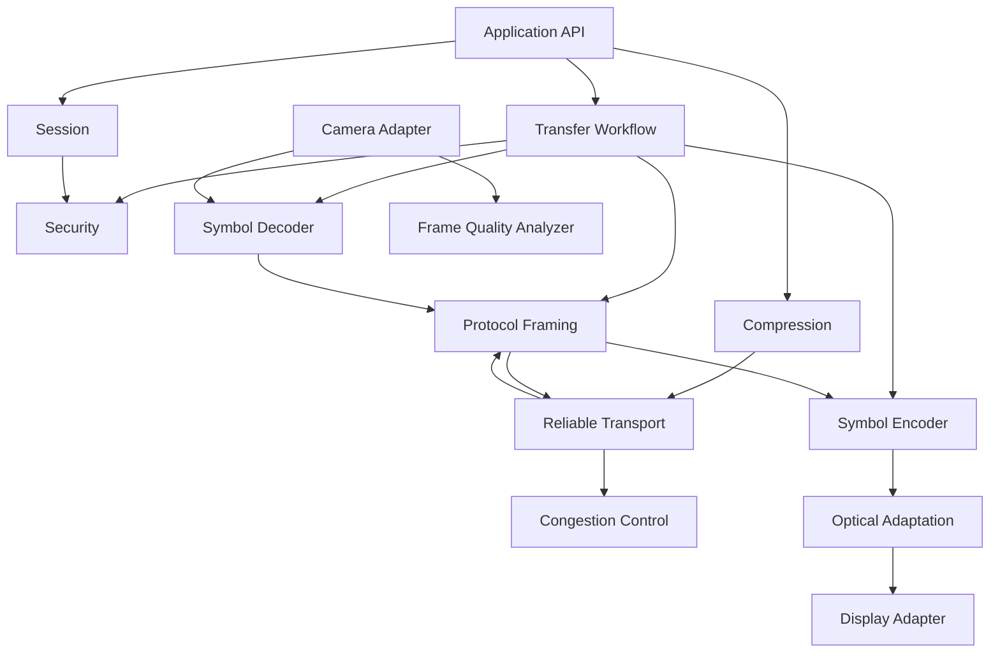
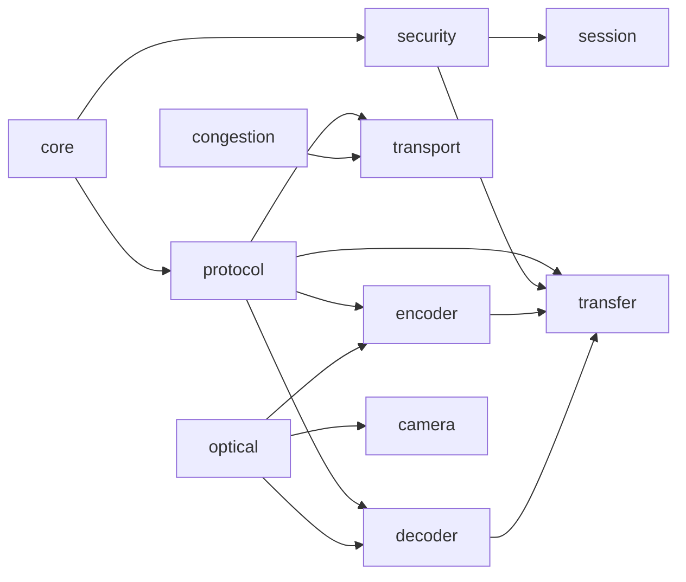
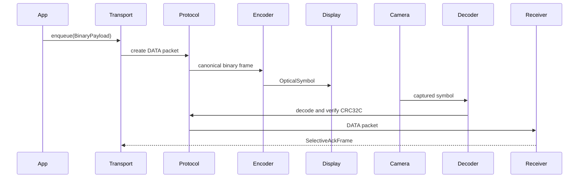
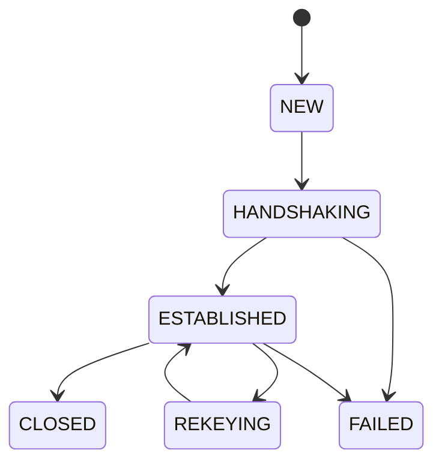

# Architecture

## Requirements

OptiLink must communicate only through optical transmission between displays and cameras. The protocol must remain independent of Wi-Fi, Bluetooth, NFC, cellular, internet, USB, and platform-specific UI frameworks.

## Architecture Overview

The architecture is layered and hexagonal:

- Domain modules: `core`, `protocol`, `security`, `session`, `transport`, `congestion`, `optical`, `compression`.
- Application workflow modules: `transfer`.
- Adapter modules: `encoder`, `decoder`, `camera`, `desktop`, `android`, `server`, `cli`.
- Validation modules: `benchmark`, `tests`, `documentation`.

Protocol frames do not know how they are rendered. Security does not know how transport schedules packets. Transport does not know whether a symbol is the current ZXing QR PNG carrier, multi-QR, RGB multiplexed, or a future optical OFDM representation.

## Component Diagram

## Package Diagram

## Sequence Diagram

## State Diagram

## Design Decisions

- Use Java 21 records for immutable domain values.
- Use JCA/JCE providers for Ed25519, X25519, HMAC-SHA-256, and AES-GCM rather than custom cryptography.
- Use CRC32C before decryption as a cheap corruption filter, not as a security mechanism.
- Use SACK and a sliding window because display-camera links have burst loss and out-of-order recovery needs.
- Keep ZXing, JavaFX, Android, OpenCV, and Spring WebFlux at adapter boundaries to prevent domain coupling.

## Known Limitations

The stack now includes QR PNG rendering/decoding, but still does not include a hardware capture loop, OpenCV perspective correction, Testcontainers integration, or Android Kotlin sources. Those remain explicit Phase 2 and Phase 3 items.
