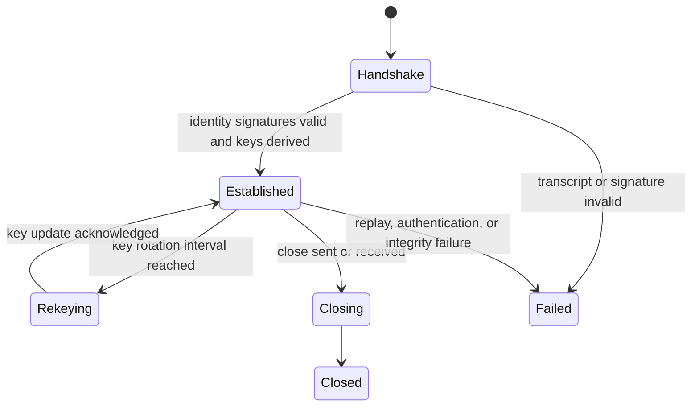

# Protocol Specification

## Requirements

The protocol must provide authenticated, reliable application messages over visual frames. It must support packet framing, sequence numbers, acknowledgements, adaptive payload sizing, replay defense hooks, and future optical encodings.

## Packet Format

All multi-byte numeric fields are big-endian.

| Offset | Bytes | Field | Description |
| --- | ---: | --- | --- |
| 0 | 4 | Magic | `0x4F50544C` (`OPTL`). |
| 4 | 1 | Version | Current version is `1`. |
| 5 | 1 | Type | `HANDSHAKE`, `DATA`, `ACK`, `KEY_UPDATE`, `CLOSE`. |
| 6 | 2 | Flags | Unsigned 16-bit extension flags. |
| 8 | 16 | Session ID | UUID identifying the secure session. |
| 24 | 8 | Sequence | Monotonic sender packet sequence. |
| 32 | 8 | ACK | Highest cumulative peer sequence observed by sender. |
| 40 | 4 | Payload length | Up to 16,384 bytes in Phase 1. |
| 44 | 4 | CRC32C | Integrity check over header fields with checksum zeroed plus payload. |
| 48 | N | Payload | Encrypted or control payload bytes. |

## Selective ACK Format

| Field | Bytes | Description |
| --- | ---: | --- |
| Cumulative ACK | 8 | Highest contiguous sequence received. |
| Range count | 4 | Number of out-of-order ranges. |
| Ranges | 16 each | Inclusive start and end sequence numbers. |

## State Machine

## Transport Behavior

- Sender chunks payloads to the active optical profile capacity.
- Sender transmits while in-flight packets are below the congestion window.
- Receiver releases payloads only in sequence order.
- Receiver emits cumulative ACK and SACK ranges for out-of-order data.
- Sender retransmits expired packets and halves the window on timeout/loss.
- Triple duplicate cumulative ACK marks the oldest unacknowledged packet for fast retransmit.

## Error Correction Stack

- Layer 1: QR-compatible Reed-Solomon correction in the visual symbol layer.
- Layer 2: CRC32C corruption detection in protocol framing.
- Layer 3: chunk-level authenticated encryption tags.
- Layer 4: application object hashes in a future object transfer profile.
- Layer 5: Ed25519 signatures for identity and session authentication.

## Extension Points

Flags, packet types, optical profiles, congestion controllers, compression strategies, and adapter modules are intentionally separated so future multi-QR, RGB multiplexing, optical OFDM, and hardware-specific decoders can be added without changing session cryptography.

## MVP Transfer Chunks

Practical MVP transfers use a chunk payload inside regular `DATA` packets:

| Field | Bytes | Description |
| --- | ---: | --- |
| Magic | 4 | `OTCH`. |
| Version | 4 | Current transfer chunk version, `1`. |
| Transfer ID | 16 | UUID shared by all chunks. |
| Index | 4 | Zero-based chunk index. |
| Total chunks | 4 | Total chunks in the transfer. |
| Chunk length | 4 | Chunk byte count. |
| Chunk bytes | N | Portion of the sealed payload. |

The receiver verifies that packet session ID and sequence number match the chunk transfer ID and index before reassembly.
